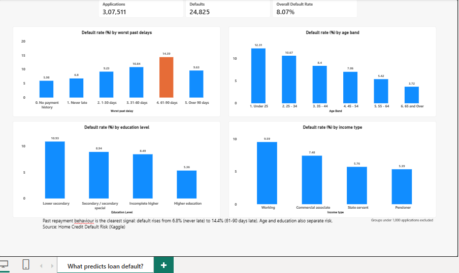

# What Predicts Loan Default? A SQL Analysis of Home Credit Data

**Business question:** In a retail lending book, which customer groups default more, and can past repayment behaviour act as an early warning?

**Headline finding:** Customers who were never late on a previous loan defaulted at **6.8%**. Those whose worst past delay was 61–90 days defaulted at **14.4%**, about double. Age and education also separated risk. Loan size relative to income was a weak signal.



## Data

- **Source:** [Home Credit Default Risk](https://www.kaggle.com/competitions/home-credit-default-risk) (Kaggle). The raw files are **not** included in this repository; please download them from Kaggle and follow its terms.
- **Used in this analysis:**
  - `application_train.csv`: 307,511 loan applications, with a default flag (`TARGET`). 24 of the 122 columns were loaded.
  - `installments_payments.csv`: 13,605,401 instalment records from customers' previous loans, covering 339,587 customers.
- **Overall default rate:** 24,825 of 307,511 applications (8.07%).

## Tools

MySQL 9.6 and MySQL Workbench (SQL), Power BI Desktop (dashboard).

## Method

1. Created a `home_credit` database and loaded both files with `LOAD DATA INFILE`, with blank cells stored as NULL.
2. Compared default rate across customer segments with `GROUP BY` and `CASE WHEN` bands (income type, education, age, loan-to-income, annuity-to-income).
3. Built a pre-aggregated table, `customer_delay` (one row per customer: worst past delay, number of instalments, number paid late), from the 13.6-million-row instalments table. Pre-aggregating cut the run time of later queries to about a second.
4. Linked `customer_delay` to the applications with a `LEFT JOIN`, so that customers with no previous loans were kept and shown as their own group.
5. Checked every result: band counts add up to 307,511 and defaults to 24,825.
6. Exported the result tables to CSV and built a one-page Power BI dashboard.

**Worst past delay** for a customer = the largest value of (actual payment day − due day) across all their previous instalments. A positive value means paid late.

## Findings

### 1. Past repayment behaviour is the clearest signal

| Worst past delay | Applications | Defaults | Default rate |
|---|---|---|---|
| No payment history | 15,876 | 950 | 5.98% |
| Never late | 136,636 | 9,292 | 6.80% |
| 1–30 days | 136,060 | 12,559 | 9.23% |
| 31–60 days | 10,248 | 1,111 | 10.84% |
| 61–90 days | 1,598 | 230 | 14.39% |
| Over 90 days | 7,093 | 683 | 9.63% |

The rate rises with the size of the past delay up to 90 days, then falls above 90 days (see below).

### 2. Inside the "over 90 days" group, longer delays look safer

| Worst past delay | Applications | Defaults | Default rate |
|---|---|---|---|
| 91–180 days | 2,097 | 245 | 11.68% |
| 181–365 days | 2,171 | 212 | 9.77% |
| Over 365 days | 2,825 | 226 | 8.00% |

Delays in this group run up to 2,884 days (almost 8 years), with an average of about 497 days. These look more like old arrears that were recorded as paid years later than like current trouble, which would explain the lower default rate. A second possible explanation is selection (customers who were this late but still approved for a new loan may have been screened more strictly). The data cannot separate the two.

### 3. Age

| Age band | Applications | Defaults | Default rate |
|---|---|---|---|
| Under 25 | 12,150 | 1,496 | 12.31% |
| 25–34 | 72,289 | 7,716 | 10.67% |
| 35–44 | 84,276 | 7,083 | 8.40% |
| 45–54 | 70,069 | 4,946 | 7.06% |
| 55–64 | 60,605 | 3,282 | 5.42% |
| 65 and over | 8,122 | 302 | 3.72% |

Default rate falls steadily with age. Customers under 35 are about 27% of applications but about 37% of defaults.

### 4. Education

| Education | Applications | Defaults | Default rate |
|---|---|---|---|
| Lower secondary | 3,816 | 417 | 10.93% |
| Secondary / secondary special | 218,391 | 19,524 | 8.94% |
| Incomplete higher | 10,277 | 872 | 8.49% |
| Higher education | 74,863 | 4,009 | 5.36% |

"Academic degree" (164 applications) is left out because the group is under 1,000 applications.

### 5. Income type

| Income type | Applications | Defaults | Default rate |
|---|---|---|---|
| Working | 158,774 | 15,224 | 9.59% |
| Commercial associate | 71,617 | 5,360 | 7.48% |
| State servant | 21,703 | 1,249 | 5.76% |
| Pensioner | 55,362 | 2,982 | 5.39% |

Four very small groups (Maternity leave, Unemployed, Student, Businessman: 55 applications in total) are excluded from the chart because the numbers are too small to read anything into.

### 6. Weaker signals

| Measure | Band range | Default rate range | Pattern |
|---|---|---|---|
| Loan amount ÷ annual income | under 2x to 6x and above | 7.23% – 8.77% | No consistent trend |
| Annuity ÷ income | under 0.10 to 0.30 and above | about 7.3% – 8.8% | Rises across the first four bands, then dips |

Loan-to-income bands: under 2x 7.48%, 2x to under 4x 8.77%, 4x to under 6x 8.20%, 6x and above 7.23%. Neither measure separates risk as well as age, education or past repayment behaviour.

## Recommendations

1. **Use past delay as one early-warning input, not a stand-alone rule.** Flagging customers whose worst past delay exceeds 30 days covers about 6% of applications at a default rate of about 10.7%, but catches only about 8% of all defaults. Flagging any lateness at all covers about half the book and about 59% of defaults. There is a trade-off between coverage and precision.
2. **Do not set policy on loan-to-income or annuity-to-income alone.** Both are weak signals in this book.
3. **Monitor the younger segments (under 35) more closely,** since they carry a disproportionate share of defaults. Age is not normally usable directly in lending decisions for regulatory and fairness reasons, so treat this as portfolio monitoring, not as a pricing or approval rule.
4. **Check how very long delays are recorded before using them in rules.** The over-90 result looks like a data effect.

## Assumptions and limitations

- These are **associations, not causes.** The work is descriptive and does not predict default.
- `AMT_ANNUITY` and `AMT_INCOME_TOTAL` are not documented with a time period, and an annual-vs-monthly comparison gave impossible values. The annuity-to-income ratio is therefore used only as a relative burden index to compare groups.
- 2,905 instalments (about 0.02% of 13.6 million) have no recorded payment date and are not counted as late.
- The instalment history covers customers' **previous Home Credit loans** only, not their current loan, and approved customers are a selected population.
- Groups under 1,000 applications are excluded from the income and education charts.
- Some customers have no previous loans. They appear as the "No payment history" group.

## Repository contents

```
sql/         numbered SQL scripts (load, build customer_delay, and one per analysis)
results/     result tables exported as CSV
dashboard/   Power BI file (.pbix) and a dashboard screenshot
```

**To reproduce:** download the data from Kaggle, copy the CSV files into your MySQL `secure_file_priv` folder, and run the SQL scripts in numbered order. For the 13.6-million-row load, raise Workbench's connection read timeout (Edit > Preferences > SQL Editor).

## About

Built by Saurabh Desale as a hands-on lending analytics project. [LinkedIn](https://www.linkedin.com/in/saurabh-desale)
